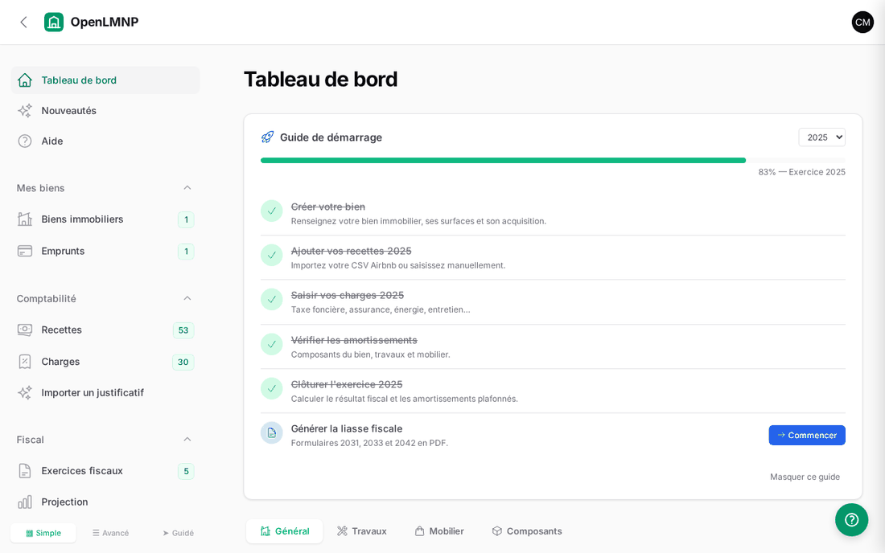
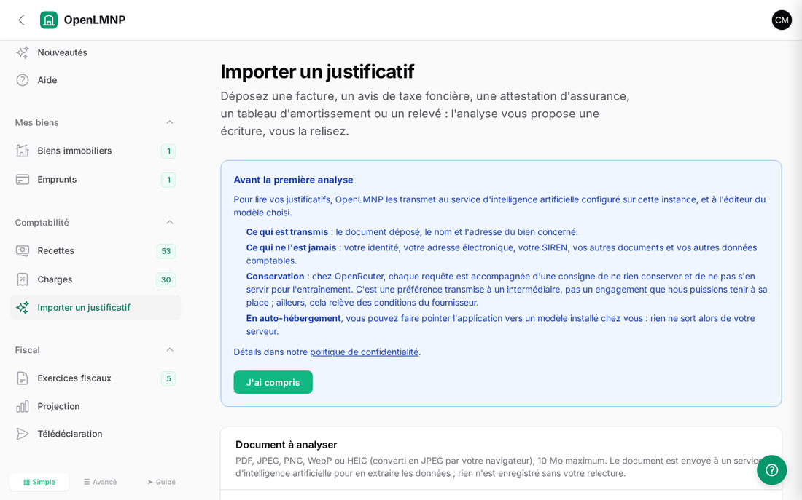
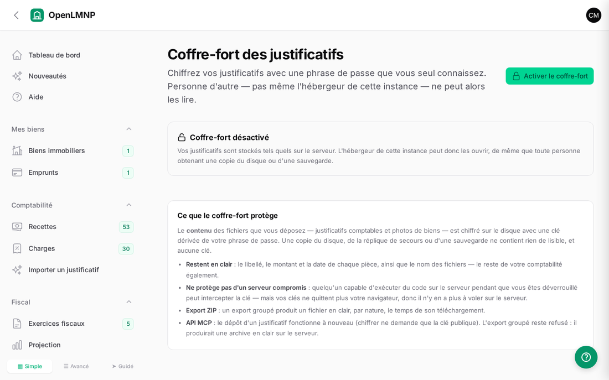
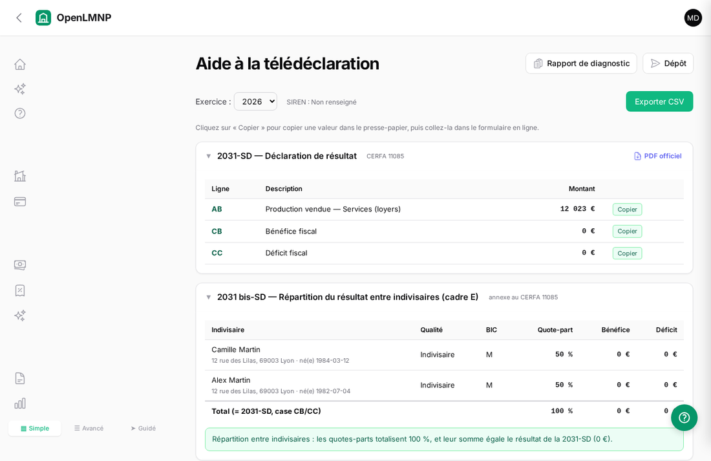

<div align="center">

# OpenLMNP

**Logiciel open source de comptabilité LMNP (Location Meublée Non Professionnelle)**

Gérez vos biens en location meublée, calculez vos amortissements,
et produisez votre liasse fiscale au régime réel, sans abonnement et chez vous.

[](https://github.com/manganate006/openlmnp/actions/workflows/tests.yml)
[](https://github.com/manganate006/openlmnp/releases)
[](LICENSE)


**[🌐 Site officiel](https://openlmnp.fr)** · **[🚀 Démo live](https://app.openlmnp.fr)** · **[📦 Installation](#installation-rapide-docker)** · **[📚 Documentation](#documentation)** · **[🇬🇧 English](README.en.md)**



</div>

> **🎯 Essayez sans rien installer** : la [démo en ligne](https://app.openlmnp.fr) crée un bac à sable
> éphémère et isolé pour chaque visiteur, pré-rempli avec plusieurs exercices de comptabilité fictive (depuis 2022).
> Connexion : `demo@openlmnp.fr` / `demo2026`.

> **🆕 Nouveau en 2.0** : coffre-fort chiffré pour vos justificatifs, analyse de justificatifs
> par IA (optionnelle, votre clé ou un modèle local), dossiers en indivision avec l'annexe
> 2031 bis. Détail dans le [journal des versions](CHANGELOG.md#200---2026-11-09) ; avant de
> mettre à jour, lisez [Mettre à jour vers la 2.0](#mettre-à-jour-vers-la-20).

## Sommaire

- [Pourquoi OpenLMNP ?](#pourquoi-openlmnp-)
- [Fonctionnalités](#fonctionnalités)
- [Captures d'écran](#captures-décran)
- [Documentation](#documentation)
- [Installation rapide (Docker)](#installation-rapide-docker)
- [Mettre à jour vers la 2.0](#mettre-à-jour-vers-la-20)
- [Autres installations](#autres-installations)
- [Configuration](#configuration)
- [Sauvegarde](#sauvegarde)
- [Tests](#tests)
- [Contribution](#contribution)
- [Comment nous soutenir ?](#-comment-nous-soutenir-)
- [Remerciements](#remerciements)
- [Licence](#licence)

## Pourquoi OpenLMNP ?

Le régime réel LMNP est presque toujours plus avantageux que le micro-BIC pour un meublé,
mais il exige des amortissements par composant, une liasse fiscale (2031, 2033) et un FEC
conforme. Les options habituelles ont chacune leur défaut :

| | **OpenLMNP** | Tableur maison | SaaS comptable | Expert-comptable |
|---|---|---|---|---|
| **Coût** | Gratuit (AGPLv3) | Gratuit | Abonnement annuel | Honoraires annuels |
| **Vos données** | Chez vous (auto-hébergé) | Chez vous | Cloud d'un tiers | Chez un tiers |
| **Amortissements par composant** | ✅ Automatiques | ⚠️ Formules à maintenir | ✅ | ✅ |
| **Liasse fiscale + FEC** | ✅ Générés | ❌ | ✅ | ✅ |
| **Calculs au centime (bcmath)** | ✅ | ⚠️ Arrondis flottants | ✅ | ✅ |

OpenLMNP automatise le régime réel de bout en bout et reste un **outil d'aide** : pour les
situations complexes (TVA para-hôtelière, passage en LMP, indivision gérée en commun...),
un expert-comptable reste recommandé.

## Fonctionnalités

### 🏠 Comptabilité & amortissements
- **Amortissement par composant** : gros œuvre, toiture, plomberie, agencements (durées standards), ventilés en pourcentage ou en montants
- **Travaux & mobilier** : amortissement dédié ou au prorata, gestion neuf/occasion
- **Emprunts** : tableau d'amortissement automatique, intérêts déductibles
- **Charges récurrentes** : génération des échéances mensuelles ou trimestrielles, duplication d'une charge
- **Écritures comptables** : génération automatique selon le plan comptable LMNP
- **Multi-biens** : adresse, surfaces, quote-part, situation (logement distinct, pièce ou logement indépendant de la résidence principale), classement micro-BIC
- **Emprunt dédié** : un prêt qui ne finance que le logement loué se déduit à 100 %, sans quote-part
- **Indivision** : dossier au nom de l'indivision, quotes-parts des indivisaires, annexe **2031 bis-SD** et montant de chacun à reporter sur sa 2042-C-PRO
- **Reprise d'un dossier existant** : assistant en 5 étapes à partir de la dernière liasse de votre cabinet, contrôlée chiffre à chiffre

### 📋 Fiscal & déclarations
- **Exercices chaînés** : reports N-1, amortissements différés, plafonnement, suivi des déficits reportables
- **Simulateur micro-BIC vs régime réel** : avec verdict chiffré, taux et plafonds officiels (au-delà du plafond, le micro-BIC est déclaré indisponible)
- **Projection pluriannuelle** : tableau sur 5 à 20 ans, année de bascule des régimes
- **Télédéclaration interactive** : lignes Cerfa 2031, 2033-A/B/C/D, 2042-C-PRO avec boutons « Copier », date et numéro de dépôt notés
- **Liasse fiscale PDF** : 2031-SD et 2033-A à D, annexes « détail du résultat » et « détail des immobilisations », contrôles de cohérence entre formulaires
- **FEC conforme** : article A.47 A-1 du LPF, 18 colonnes, format légal
- **Déclaration de TVA** : pour un bien assujetti

### 🔌 Import & intégrations
- **Import CSV Airbnb / Booking** : formats FR/EN, détection des doublons ; import CSV générique des recettes, charges, mobilier et travaux
- **Analyse de justificatifs par IA** *(optionnelle, désactivée par défaut)* : déposez une facture, un avis de taxe foncière, un tableau d'amortissement bancaire, un relevé de compte ou le relevé annuel Airbnb, Booking ou Abritel. Les champs sont proposés, vous relisez avant d'enregistrer
- **Lecture IA de la liasse** dans l'assistant de reprise : le tableau 2033-C et les cases de report sont pré-remplis depuis la liasse de votre cabinet, à relire
- **Fournisseurs d'IA au choix** : OpenRouter, Anthropic, Google, OpenAI, Mistral (justificatifs traités en Europe), ou un modèle installé chez vous, et alors rien ne sort
- **Export CSV** : recettes, charges, télédéclaration
- **API MCP (46 outils)** : pilotez votre comptabilité depuis un assistant IA (Claude, etc.), y compris un dossier d'indivision partagé
- **Assistant intégré (optionnel)** : répond à vos questions d'utilisation, sans jamais donner de conseil fiscal ni toucher à vos données
- **Nouvelles versions signalées** : dans l'application, d'après les releases GitHub (mise à jour d'une instance Docker par `docker pull`)

### 🏛️ Données publiques
Chaque service se coupe par une variable, et chacun dit ce qu'il envoie :
- **Valeur vénale (DVF)** : estimée d'après les ventes réelles de la commune ; au clic, seule la commune part vers data.gouv.fr
- **Sirene** : entreprise active ou cessée, forme juridique et code APE de votre SIREN ; au clic, seul le SIREN part
- **DPE (ADEME)** : diagnostic retrouvé à l'adresse du bien et ce que sa classe permet ; au clic, l'adresse part vers l'IGN et l'ADEME
- **Carte des loyers (ANIL)** : repère de loyer au m² dans le simulateur, importé chaque année sans aucune donnée du bien
- **Autocomplétion d'adresse (BAN)** : le début d'adresse part vers l'IGN pendant la frappe

### 🛡️ Confort & sécurité
- **Coffre-fort des justificatifs** *(optionnel)* : fichiers chiffrés avec une phrase de passe que l'instance ne connaît pas. Perdue, elle ne se récupère pas
- **Multi-utilisateurs** : chaque propriétaire voit uniquement ses données ; inscription ouverte, fermée ou **sur invitation**
- **Dossiers liés** *(optionnel)* : un dossier d'indivision partagé entre indivisaires, ouvert d'un clic depuis son propre compte
- **Assistants guidés** : onboarding, création de bien, clôture fiscale, emprunt, import annuel
- **Justificatifs** : pièces jointes aux charges, travaux et mobilier, export ZIP
- **Guide intégré & badges de progression** : mise en route, suivi régulier, déclaration annuelle
- **Rapport de diagnostic** pour signaler un problème de calcul, **mode sombre**, suite de [tests automatisés](docs/TESTS.md) rejouée à chaque push

## Captures d'écran

| Import d'un justificatif (IA) | Coffre-fort | Indivision et 2031 bis |
|---|---|---|
| [](docs/screenshots/import-justificatif.png) | [](docs/screenshots/coffre-fort.png) | [](docs/screenshots/indivision-2031bis.png) |

D'autres captures : [simulateur](docs/screenshots/simulateur.png) · [projection](docs/screenshots/projection.png) · [télédéclaration](docs/screenshots/teledeclaration.png) · [tableau de bord](docs/screenshots/dashboard.png) · [charges](docs/screenshots/charges.png)

## Documentation

[Installation](docs/INSTALLATION.md) · [Fonctionnalités](docs/FONCTIONNALITES.md) · [FAQ](docs/FAQ.md) ·
[Guide fiscal LMNP / Airbnb](docs/fiscalite-lmnp-airbnb.md) · [Mode démonstration](docs/DEMO.md) ·
[Tests](docs/TESTS.md) · [Conception de l'interface](docs/ui-design-openlmnp.md) ·
[Journal des versions](CHANGELOG.md) · [Sécurité](SECURITY.md) · [Contribuer](CONTRIBUTING.md)

## Stack technique

Laravel 13 · Filament 5 · Livewire 4 · SQLite (PostgreSQL en option) · DomPDF · calculs en
PHP bcmath (précision décimale) · Pest PHP · Docker (amd64 et arm64).

## Installation rapide (Docker)

Avec l'image officielle [`manganate06/openlmnp`](https://hub.docker.com/r/manganate06/openlmnp) :

```bash
docker run -d --name openlmnp -p 8090:8000 \
  -v openlmnp-database:/var/www/html/database \
  -v openlmnp-storage:/var/www/html/storage \
  --restart unless-stopped manganate06/openlmnp:latest
```

Ou en construisant l'image depuis les sources, avec le [`docker-compose.yml`](docker-compose.yml) fourni :

```bash
git clone https://github.com/manganate006/openlmnp.git
cd openlmnp
docker compose up -d
```

Accès : `http://localhost:8090`
Première connexion : créez votre compte sur `/register` : le premier compte devient
administrateur, et l'inscription se referme ensuite d'elle-même.

## Mettre à jour vers la 2.0

**Sauvegardez d'abord** (voir [Sauvegarde](#sauvegarde)), puis `docker pull
manganate06/openlmnp:latest` et relancez le conteneur sur les mêmes volumes.

- Le conteneur tourne sous `www-data` : les droits des volumes sont repris au démarrage.
- **Retour en 1.6.11 possible** sans restaurer la base, mais un **coffre-fort activé** doit
  être déchiffré avant : `php artisan openlmnp:vault-migrate <email> --decrypt`.
- L'IA reste éteinte (`AI_ENABLED=false`) tant que vous ne l'avez pas configurée.
- Le FEC des exercices clôturés avant la 2.0 comptait deux fois la commission de plateforme :
  `php artisan openlmnp:repair-accounting-entries` les repère (`--fix --closed` pour refaire).

Détail : [journal des versions](CHANGELOG.md#200---2026-11-09) et
[docs/INSTALLATION.md](docs/INSTALLATION.md#mise-à-jour).

## Autres installations

- **PaaS (Coolify, Dokploy, Easypanel)** : [`docker-compose.coolify.yml`](docker-compose.coolify.yml)
  est prêt à l'emploi ([détails](docs/INSTALLATION.md#déploiement-sur-un-paas-coolify-dokploy-easypanel)).
- **LXC Proxmox** (Debian 13, nginx, PHP 8.4-FPM ; mot de passe admin aléatoire dans
  `/opt/openlmnp/admin_credentials.txt`) :
  ```bash
  bash -c "$(curl -fsSL https://raw.githubusercontent.com/manganate006/openlmnp/main/community-scripts/ct/openlmnp.sh)"
  ```
- **Développement** :
  ```bash
  git clone https://github.com/manganate006/openlmnp.git && cd openlmnp
  composer install && cp .env.docker .env && php artisan key:generate
  touch database/database.sqlite && php artisan migrate:fresh --seed && php artisan serve
  ```

## Configuration

Après la création du compte administrateur, ajoutez votre SIREN dans votre profil pour les
documents fiscaux. Variables principales :

| Variable | Description | Défaut |
|----------|-------------|--------|
| `DB_CONNECTION` | Base de données | `sqlite` |
| `DB_DATABASE` | Chemin SQLite | `database/database.sqlite` |
| `APP_URL` | Adresse publique de l'instance, schéma compris (`https://lmnp.exemple.fr`) | `http://localhost` |
| `TRUSTED_HOSTS` | Autres noms d'hôte acceptés quand `APP_URL` porte un domaine (IP, alias), séparés par des virgules (sinon erreur 400) | vide |
| `APP_LOCALE` | Langue | `fr` |
| `ALLOW_REGISTRATION` | Inscription : `auto` (jusqu'au premier compte), `true` (toujours), `false` (jamais), `invite` (sur invitation d'un administrateur) | `auto` |
| `AI_ENABLED` / `AI_PROVIDER` | Fonctions d'IA et fournisseur (`openrouter`, `anthropic`, `gemini`, `mistral`, `openai`, `local`) ; voir [le guide](docs/INSTALLATION.md#intelligence-artificielle-optionnel) | `false` / `auto` |
| `DOCUMENTS_VAULT_ENABLED` | Propose le coffre-fort des justificatifs (chaque utilisateur l'active ou non) | `true` |
| `LINKED_DOSSIERS_ENABLED` | Dossiers liés, partagés entre indivisaires | `false` |
| `FEEDBACK_ENABLED` | Invitation unique à donner son avis ; le retour reste dans votre base, rien n'est envoyé sans vous | `true` |
| `TELEMETRY_ENABLED` | Signal quotidien anonyme (identifiant aléatoire + version) pour compter les instances installées ; aucune donnée comptable ni personnelle | `true` |
| `DVF_ENABLED`, `SIRENE_ENABLED`, `DPE_ENABLED`, `RENT_MAP_ENABLED`, `ADDRESS_LOOKUP_ENABLED` | Services de données publiques (voir [Fonctionnalités](#fonctionnalités)), un interrupteur chacun | `true` |

### Emails (optionnel)

Aucun email ne part par défaut. Le lien « Mot de passe oublié » s'active avec les variables
`MAIL_*` ; sans SMTP, `php artisan openlmnp:reset-password vous@exemple.fr` depuis le serveur.
Toutes les variables : [docs/INSTALLATION.md](docs/INSTALLATION.md).

## Sauvegarde

Deux volumes : `database` (SQLite, en mode WAL) et `storage` (justificatifs). Ne copiez pas
`database.sqlite` à chaud : utilisez `sqlite3 database.sqlite ".backup 'instantane.sqlite'"`
ou arrêtez le conteneur. [Procédure complète](docs/INSTALLATION.md#sauvegarde-et-restauration).

## Tests

Suite Pest PHP rejouée à chaque push (calculs, liasse et FEC, pages, isolation multi-utilisateurs) :
`vendor/bin/pest`, ou `vendor/bin/pest --filter="Depreciation"` pour un groupe.
Détail : [docs/TESTS.md](docs/TESTS.md).

## Contribution

Les contributions sont les bienvenues ! Merci d'ouvrir une issue avant de soumettre une PR,
et de lire [CONTRIBUTING.md](CONTRIBUTING.md). Une faille de sécurité se signale **en privé**,
jamais dans une issue publique : voir [SECURITY.md](SECURITY.md). Avant de proposer une PR, lancez `vendor/bin/pest`.

## 💛 Comment nous soutenir ?

OpenLMNP est développé sur mon temps libre. Si l'outil vous rend service : ⭐ une étoile sur
le dépôt, 💛 [GitHub Sponsors](https://github.com/sponsors/manganate006), ou 🐛 un bug ou une
idée dans les [issues](https://github.com/manganate006/openlmnp/issues). Merci !

## Remerciements

OpenLMNP doit beaucoup à celles et ceux qui l'ont installé, confronté à leur propre dossier
et nous ont dit ce qui n'allait pas : [@cocool97](https://github.com/cocool97),
[@ptitzgeg-on-git](https://github.com/ptitzgeg-on-git), [@ovrtn](https://github.com/ovrtn)
et [@DamienFr](https://github.com/DamienFr). Le détail de leurs contributions (correctifs,
signalements, sécurité) est sur la page [Remerciements](https://openlmnp.fr/remerciements).

## Licence

[AGPLv3](LICENSE), logiciel libre. Vous pouvez l'utiliser, le modifier et le redistribuer
à condition de partager les modifications sous la même licence.

## Crédits

Construit avec [Laravel](https://laravel.com), [Filament](https://filamentphp.com) et [Pest PHP](https://pestphp.com).

---

<div align="center">
<sub>OpenLMNP est un outil d'aide à la comptabilité. Il ne remplace pas un expert-comptable pour les cas complexes.</sub>
</div>
